# Poly Haven: Furniture models

**83 assets from [Poly Haven](https://polyhaven.com), dedicated to the public domain under [CC0](https://polyhaven.com/license).** Use them in any game, free or paid, and change them however you like; no credit is needed.

3D models as glTF at 1K and 2K texture resolution, each folder self-contained (`.gltf`, `.bin`, `textures/`). 626.9 MB in all.

This is a copy kept by [zuujis-cc0](https://github.com/zuujis-cc0) so game makers can take single files from GitHub. It is not made by or affiliated with Poly Haven: the originals, often in more formats and higher resolutions, are on [polyhaven.com](https://polyhaven.com). If they help you, consider [supporting Poly Haven](https://www.patreon.com/polyhaven/overview).

Every file is listed in [MANIFEST.tsv](MANIFEST.tsv) with its size and SHA-256. More free assets: [the Zuujis collection](https://github.com/zuujis-cc0/free-game-assets#readme).

| | | | |
| :-: | :-: | :-: | :-: |
| <a href="ArmChair_01">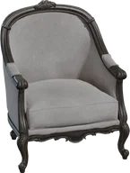</a> <b><a href="ArmChair_01">Arm Chair 01</a></b> by Kirill Sannikov · <a href="https://polyhaven.com/a/ArmChair_01">source</a> | <a href="BarberShopChair_01">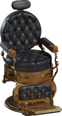</a> <b><a href="BarberShopChair_01">Barber Shop Chair 01</a></b> by Fernando Quinn · <a href="https://polyhaven.com/a/BarberShopChair_01">source</a> | <a href="ClassicConsole_01">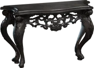</a> <b><a href="ClassicConsole_01">Classic Console 01</a></b> by Kirill Sannikov · <a href="https://polyhaven.com/a/ClassicConsole_01">source</a> | <a href="ClassicNightstand_01">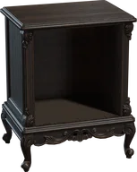</a> <b><a href="ClassicNightstand_01">Classic Nightstand 01</a></b> by Kirill Sannikov · <a href="https://polyhaven.com/a/ClassicNightstand_01">source</a> |
| <a href="CoffeeCart_01">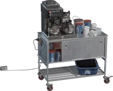</a> <b><a href="CoffeeCart_01">Coffee Cart 01</a></b> by Joe Seabuhr · <a href="https://polyhaven.com/a/CoffeeCart_01">source</a> | <a href="CoffeeTable_01">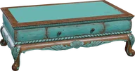</a> <b><a href="CoffeeTable_01">Coffee Table 01</a></b> by Fernando Quinn · <a href="https://polyhaven.com/a/CoffeeTable_01">source</a> | <a href="GothicBed_01">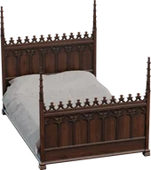</a> <b><a href="GothicBed_01">Gothic Bed 01</a></b> by Kirill Sannikov · <a href="https://polyhaven.com/a/GothicBed_01">source</a> | <a href="GothicCabinet_01">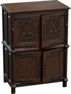</a> <b><a href="GothicCabinet_01">Gothic Cabinet 01</a></b> by Kirill Sannikov · <a href="https://polyhaven.com/a/GothicCabinet_01">source</a> |
| <a href="GothicCommode_01">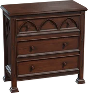</a> <b><a href="GothicCommode_01">Gothic Commode 01</a></b> by Kirill Sannikov · <a href="https://polyhaven.com/a/GothicCommode_01">source</a> | <a href="GreenChair_01">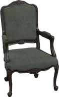</a> <b><a href="GreenChair_01">Green Chair 01</a></b> by Kirill Sannikov · <a href="https://polyhaven.com/a/GreenChair_01">source</a> | <a href="Ottoman_01">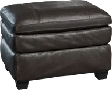</a> <b><a href="Ottoman_01">Ottoman 01</a></b> by Caspian Fortune · <a href="https://polyhaven.com/a/Ottoman_01">source</a> | <a href="Rockingchair_01">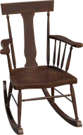</a> <b><a href="Rockingchair_01">Rockingchair 01</a></b> by Jorge Camacho · <a href="https://polyhaven.com/a/Rockingchair_01">source</a> |
| <a href="SchoolChair_01">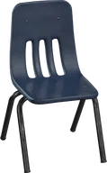</a> <b><a href="SchoolChair_01">School Chair 01</a></b> by Ethan Place · <a href="https://polyhaven.com/a/SchoolChair_01">source</a> | <a href="SchoolDesk_01">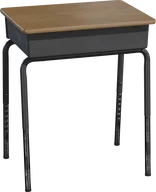</a> <b><a href="SchoolDesk_01">School Desk 01</a></b> by Ethan Place · <a href="https://polyhaven.com/a/SchoolDesk_01">source</a> |  <b><a href="Shelf_01">Shelf 01</a></b> by Gabriel Radić · <a href="https://polyhaven.com/a/Shelf_01">source</a> | <a href="Sofa_01">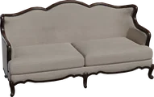</a> <b><a href="Sofa_01">Sofa 01</a></b> by Kirill Sannikov · <a href="https://polyhaven.com/a/Sofa_01">source</a> |
| <a href="WoodenChair_01">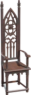</a> <b><a href="WoodenChair_01">Wooden Chair 01</a></b> by Jake Mobley · <a href="https://polyhaven.com/a/WoodenChair_01">source</a> | <a href="WoodenTable_01">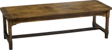</a> <b><a href="WoodenTable_01">Wooden Table 01</a></b> by Ethan Place · <a href="https://polyhaven.com/a/WoodenTable_01">source</a> |  <b><a href="WoodenTable_02">Wooden Table 02</a></b> by Fran Calvente · <a href="https://polyhaven.com/a/WoodenTable_02">source</a> | <a href="WoodenTable_03">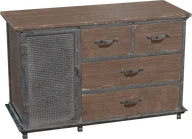</a> <b><a href="WoodenTable_03">Wooden Table 03</a></b> by Gabriel Radić · <a href="https://polyhaven.com/a/WoodenTable_03">source</a> |
| <a href="bar_chair_round_01">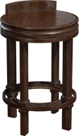</a> <b><a href="bar_chair_round_01">Bar Chair Round 01</a></b> by Dairon Sanchez · <a href="https://polyhaven.com/a/bar_chair_round_01">source</a> | <a href="chinese_armchair">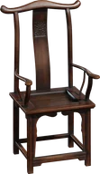</a> <b><a href="chinese_armchair">Chinese Armchair</a></b> by Kirill Sannikov · <a href="https://polyhaven.com/a/chinese_armchair">source</a> | <a href="chinese_cabinet">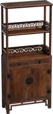</a> <b><a href="chinese_cabinet">Chinese Cabinet</a></b> by Kirill Sannikov · <a href="https://polyhaven.com/a/chinese_cabinet">source</a> | <a href="chinese_commode">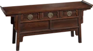</a> <b><a href="chinese_commode">Chinese Commode</a></b> by Kirill Sannikov · <a href="https://polyhaven.com/a/chinese_commode">source</a> |
| <a href="chinese_console_table">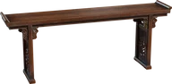</a> <b><a href="chinese_console_table">Chinese Console Table</a></b> by Kirill Sannikov · <a href="https://polyhaven.com/a/chinese_console_table">source</a> | <a href="chinese_sofa">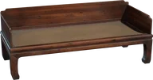</a> <b><a href="chinese_sofa">Chinese Sofa</a></b> by Kirill Sannikov · <a href="https://polyhaven.com/a/chinese_sofa">source</a> | <a href="chinese_stool">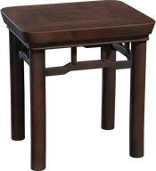</a> <b><a href="chinese_stool">Chinese Stool</a></b> by Kirill Sannikov · <a href="https://polyhaven.com/a/chinese_stool">source</a> | <a href="chinese_tea_table">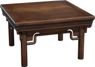</a> <b><a href="chinese_tea_table">Chinese Tea Table</a></b> by Kirill Sannikov · <a href="https://polyhaven.com/a/chinese_tea_table">source</a> |
| <a href="coffee_table_round_01">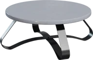</a> <b><a href="coffee_table_round_01">Coffee Table Round 01</a></b> by Ulan Cabanilla · <a href="https://polyhaven.com/a/coffee_table_round_01">source</a> | <a href="dining_chair_02">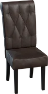</a> <b><a href="dining_chair_02">Dining Chair 02</a></b> by James Ray Cock · <a href="https://polyhaven.com/a/dining_chair_02">source</a> | <a href="dining_table">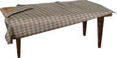</a> <b><a href="dining_table">Dining Table</a></b> by Aron Łyczek · <a href="https://polyhaven.com/a/dining_table">source</a> | <a href="drawer_cabinet">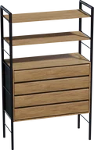</a> <b><a href="drawer_cabinet">Drawer Cabinet</a></b> by Ulan Cabanilla · <a href="https://polyhaven.com/a/drawer_cabinet">source</a> |
| <a href="folding_wooden_stool">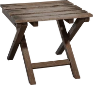</a> <b><a href="folding_wooden_stool">Folding Wooden Stool</a></b> by Ulan Cabanilla · <a href="https://polyhaven.com/a/folding_wooden_stool">source</a> | <a href="gallinera_chair">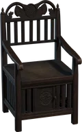</a> <b><a href="gallinera_chair">Gallinera Chair</a></b> by Ulan Cabanilla · <a href="https://polyhaven.com/a/gallinera_chair">source</a> | <a href="gallinera_table">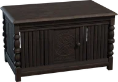</a> <b><a href="gallinera_table">Gallinera Table</a></b> by Ulan Cabanilla · <a href="https://polyhaven.com/a/gallinera_table">source</a> |  <b><a href="gothic_coffee_table">Gothic Coffee Table</a></b> by Ulan Cabanilla · <a href="https://polyhaven.com/a/gothic_coffee_table">source</a> |
| <a href="hand_truck">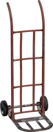</a> <b><a href="hand_truck">Hand Truck</a></b> by Mutanzom3D · <a href="https://polyhaven.com/a/hand_truck">source</a> | <a href="industrial_coffee_table">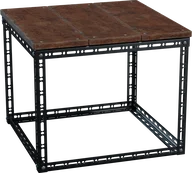</a> <b><a href="industrial_coffee_table">Industrial Coffee Table</a></b> by Ulan Cabanilla · <a href="https://polyhaven.com/a/industrial_coffee_table">source</a> | <a href="industrial_storage_cart">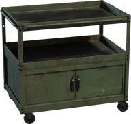</a> <b><a href="industrial_storage_cart">Industrial Storage Cart</a></b> by Jule Bielitz · <a href="https://polyhaven.com/a/industrial_storage_cart">source</a> | <a href="metal_office_desk">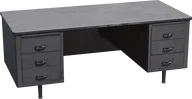</a> <b><a href="metal_office_desk">Metal Office Desk</a></b> by Ulan Cabanilla · <a href="https://polyhaven.com/a/metal_office_desk">source</a> |
| <a href="metal_stool_01">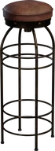</a> <b><a href="metal_stool_01">Metal Stool 01</a></b> by Ulan Cabanilla · <a href="https://polyhaven.com/a/metal_stool_01">source</a> | <a href="metal_stool_02">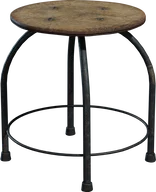</a> <b><a href="metal_stool_02">Metal Stool 02</a></b> by Ulan Cabanilla · <a href="https://polyhaven.com/a/metal_stool_02">source</a> |  <b><a href="metal_stool_03">Metal Stool 03</a></b> by Flo Tasser · <a href="https://polyhaven.com/a/metal_stool_03">source</a> | <a href="mid_century_lounge_chair">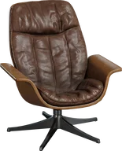</a> <b><a href="mid_century_lounge_chair">Mid Century Lounge Chair</a></b> by Kuutti Siitonen · <a href="https://polyhaven.com/a/mid_century_lounge_chair">source</a> |
| <a href="modern_arm_chair_01">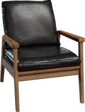</a> <b><a href="modern_arm_chair_01">Modern Arm Chair 01</a></b> by Vibrant Nordic · <a href="https://polyhaven.com/a/modern_arm_chair_01">source</a> | <a href="modern_coffee_table_01">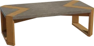</a> <b><a href="modern_coffee_table_01">Modern Coffee Table 01</a></b> by Amin · <a href="https://polyhaven.com/a/modern_coffee_table_01">source</a> | <a href="modern_coffee_table_02">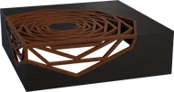</a> <b><a href="modern_coffee_table_02">Modern Coffee Table 02</a></b> by Amin · <a href="https://polyhaven.com/a/modern_coffee_table_02">source</a> | <a href="modern_wooden_cabinet">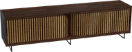</a> <b><a href="modern_wooden_cabinet">Modern Wooden Cabinet</a></b> by Patrik Pangerl · <a href="https://polyhaven.com/a/modern_wooden_cabinet">source</a> |
| <a href="modular_street_seating">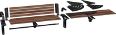</a> <b><a href="modular_street_seating">Modular Street Seating</a></b> by Stuart Attenborrow · <a href="https://polyhaven.com/a/modular_street_seating">source</a> | <a href="old_bed_frame">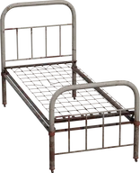</a> <b><a href="old_bed_frame">Old Bed Frame</a></b> by Luca B · <a href="https://polyhaven.com/a/old_bed_frame">source</a> | <a href="outdoor_table_chair_set_01">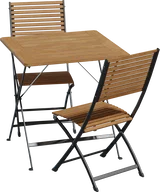</a> <b><a href="outdoor_table_chair_set_01">Outdoor Table Chair Set 01</a></b> by James Ray Cock · <a href="https://polyhaven.com/a/outdoor_table_chair_set_01">source</a> | <a href="painted_wooden_bench">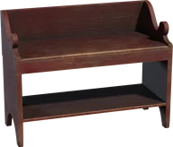</a> <b><a href="painted_wooden_bench">Painted Wooden Bench</a></b> by Kirill Sannikov · <a href="https://polyhaven.com/a/painted_wooden_bench">source</a> |
| <a href="painted_wooden_cabinet">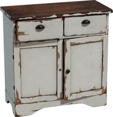</a> <b><a href="painted_wooden_cabinet">Painted Wooden Cabinet</a></b> by Kirill Sannikov · <a href="https://polyhaven.com/a/painted_wooden_cabinet">source</a> | <a href="painted_wooden_cabinet_02">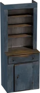</a> <b><a href="painted_wooden_cabinet_02">Painted Wooden Cabinet 02</a></b> by Kirill Sannikov · <a href="https://polyhaven.com/a/painted_wooden_cabinet_02">source</a> |  <b><a href="painted_wooden_chair_01">Painted Wooden Chair 01</a></b> by Kuutti Siitonen · <a href="https://polyhaven.com/a/painted_wooden_chair_01">source</a> |  <b><a href="painted_wooden_chair_02">Painted Wooden Chair 02</a></b> by Kirill Sannikov · <a href="https://polyhaven.com/a/painted_wooden_chair_02">source</a> |
|  <b><a href="painted_wooden_nightstand">Painted Wooden Nightstand</a></b> by Kirill Sannikov · <a href="https://polyhaven.com/a/painted_wooden_nightstand">source</a> |  <b><a href="painted_wooden_shelves">Painted Wooden Shelves</a></b> by Kirill Sannikov · <a href="https://polyhaven.com/a/painted_wooden_shelves">source</a> |  <b><a href="painted_wooden_sofa">Painted Wooden Sofa</a></b> by Kirill Sannikov · <a href="https://polyhaven.com/a/painted_wooden_sofa">source</a> |  <b><a href="painted_wooden_stool">Painted Wooden Stool</a></b> by Kirill Sannikov · <a href="https://polyhaven.com/a/painted_wooden_stool">source</a> |
|  <b><a href="painted_wooden_table">Painted Wooden Table</a></b> by Kirill Sannikov · <a href="https://polyhaven.com/a/painted_wooden_table">source</a> |  <b><a href="plastic_monobloc_chair_01">Plastic Monobloc Chair 01</a></b> by Kuutti Siitonen · <a href="https://polyhaven.com/a/plastic_monobloc_chair_01">source</a> |  <b><a href="round_wooden_table_01">Round Wooden Table 01</a></b> by Ulan Cabanilla · <a href="https://polyhaven.com/a/round_wooden_table_01">source</a> |  <b><a href="round_wooden_table_02">Round Wooden Table 02</a></b> by Ulan Cabanilla · <a href="https://polyhaven.com/a/round_wooden_table_02">source</a> |
|  <b><a href="side_table_01">Side Table 01</a></b> by James Ray Cock · <a href="https://polyhaven.com/a/side_table_01">source</a> |  <b><a href="side_table_tall_01">Side Table Tall 01</a></b> by James Ray Cock · <a href="https://polyhaven.com/a/side_table_tall_01">source</a> |  <b><a href="small_wooden_table_01">Small Wooden Table 01</a></b> by Ulan Cabanilla · <a href="https://polyhaven.com/a/small_wooden_table_01">source</a> |  <b><a href="sofa_02">Sofa 02</a></b> by Kirill Sannikov · <a href="https://polyhaven.com/a/sofa_02">source</a> |
|  <b><a href="sofa_03">Sofa 03</a></b> by Fran Calvente · <a href="https://polyhaven.com/a/sofa_03">source</a> |  <b><a href="steel_frame_shelves_01">Steel Frame Shelves 01</a></b> by James Ray Cock · <a href="https://polyhaven.com/a/steel_frame_shelves_01">source</a> |  <b><a href="steel_frame_shelves_02">Steel Frame Shelves 02</a></b> by James Ray Cock · <a href="https://polyhaven.com/a/steel_frame_shelves_02">source</a> |  <b><a href="steel_frame_shelves_03">Steel Frame Shelves 03</a></b> by Ulan Cabanilla · <a href="https://polyhaven.com/a/steel_frame_shelves_03">source</a> |
|  <b><a href="tool_cart">Tool Cart</a></b> by Savva Zakharov · <a href="https://polyhaven.com/a/tool_cart">source</a> |  <b><a href="vintage_cabinet_01">Vintage Cabinet 01</a></b> by Rico Cilliers · <a href="https://polyhaven.com/a/vintage_cabinet_01">source</a> |  <b><a href="vintage_day_bed">Vintage Day Bed</a></b> by Aron Łyczek · <a href="https://polyhaven.com/a/vintage_day_bed">source</a> |  <b><a href="vintage_wooden_drawer_01">Vintage Wooden Drawer 01</a></b> by James Ray Cock · <a href="https://polyhaven.com/a/vintage_wooden_drawer_01">source</a> |
|  <b><a href="wooden_bookshelf_worn">Wooden Bookshelf Worn</a></b> by Ulan Cabanilla · <a href="https://polyhaven.com/a/wooden_bookshelf_worn">source</a> |  <b><a href="wooden_display_shelves_01">Wooden Display Shelves 01</a></b> by James Ray Cock · <a href="https://polyhaven.com/a/wooden_display_shelves_01">source</a> |  <b><a href="wooden_picnic_table">Wooden Picnic Table</a></b> by Ulan Cabanilla · <a href="https://polyhaven.com/a/wooden_picnic_table">source</a> |  <b><a href="wooden_stool_01">Wooden Stool 01</a></b> by Kuutti Siitonen · <a href="https://polyhaven.com/a/wooden_stool_01">source</a> |
|  <b><a href="wooden_stool_02">Wooden Stool 02</a></b> by Kuutti Siitonen · <a href="https://polyhaven.com/a/wooden_stool_02">source</a> |  <b><a href="wooden_table_02">Wooden Table 02</a></b> by Serhii Khromov · <a href="https://polyhaven.com/a/wooden_table_02">source</a> |  <b><a href="worn_metal_rack">Worn Metal Rack</a></b> by Luca B · <a href="https://polyhaven.com/a/worn_metal_rack">source</a> |  |

---

Kept up to date by this repository's own [update workflow](.github/workflows/update.yml), with code and plan from [cc0-mirror](https://github.com/zuujis-cc0/cc0-mirror). Something wrong? [Open an issue there](https://github.com/zuujis-cc0/cc0-mirror/issues/new) or use the [private report form](https://games.zuujis.com/report).
